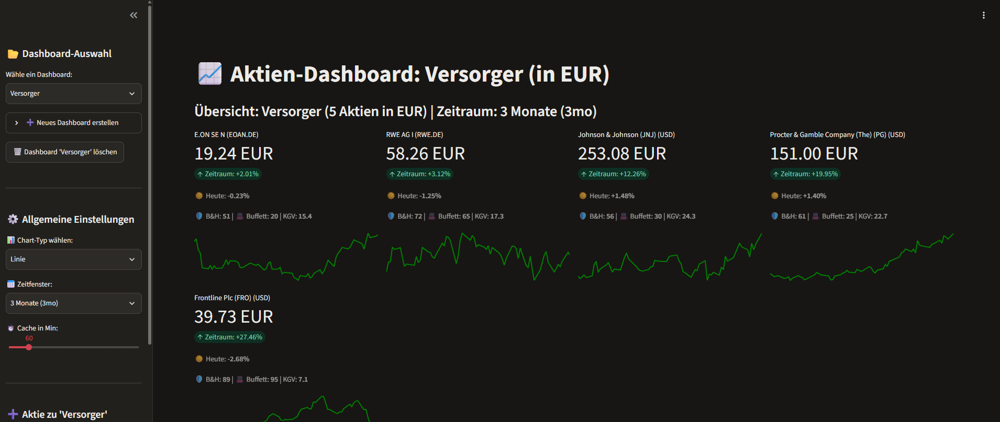
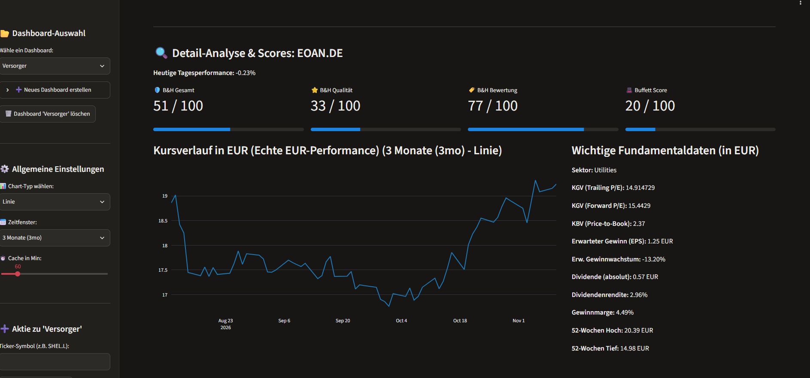
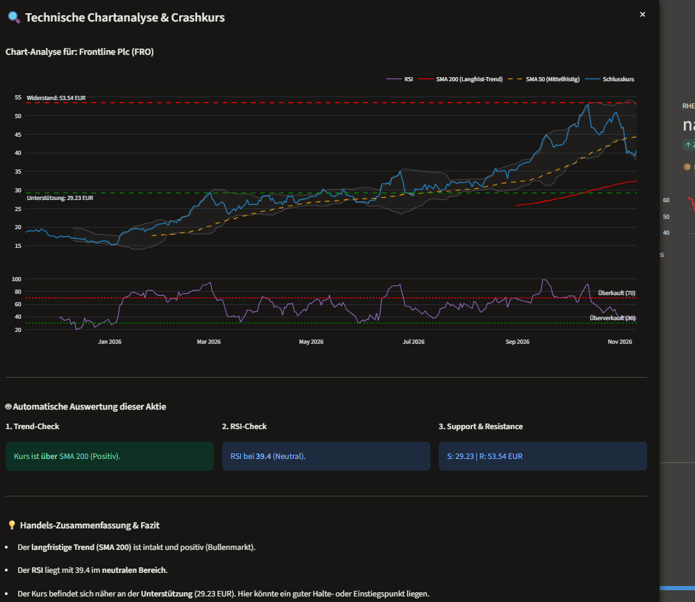

# 📈 Stock Dashboard

Dashboard:
Ein modulares Aktien-Analyse-Dashboard auf Basis von Python, Streamlit und yfinance. Bewertet Aktien nach verschiedenen Strategien (Buy & Hold, Buffett Value Investing, Trading) mit tagesgenauer EUR-Währungsumrechnung.

Chartanalyse:
Chartanalyse-Modul: Automatisiert die Auswertung von Kursdaten und übersetzt technische Indikatoren in klare Aussagen über Trendrichtung, Marktstärke und kritische Preiszonen.

## Hinweis zur Nutzung

> [!WARNING]
> **Keine Anlageberatung.** Das Aktien-Dashboard dient der Information und der eigenen Analyse. Es gibt keine Kauf- oder Verkaufsempfehlungen.
>
> Die Scores werden anhand festgelegter Regeln aus Kurs- und Fundamentaldaten berechnet. Ein hoher Score zeigt, dass eine Aktie nach diesen Regeln viele Punkte erhält. Er gibt keine Auskunft darüber, wie wahrscheinlich ein Kursgewinn ist.
>
> Die verwendeten Daten können unvollständig, fehlerhaft oder verzögert sein. Prüfe die Daten, bevor du sie für eine Anlageentscheidung verwendest.


## Übersicht



## 🚀 Features

- **Multi-Scoring Engine:** Detaillierte Auswertung nach Buy & Hold (interpolierte Qualität & Bewertung), Buffett Burggraben-Kriterien und Momentum-Trading.
- **Echte EUR-Performance:** Tagesgenauer Abgleich historischer Wechselkurse (`pd.merge`) zur korrekten Darstellung von US-Aktien in Euro.
- **Kategorien & Persistence:** Dynamische Dashboard-Erstellung und Verwaltung via `config.json`.
- **Interaktive Charts:** Plotly-Visualisierungen (Linie, Fläche, Candlestick) mit Intraday-Tagesverlauf.
- **Chartanalyse:** Übersetzt rohe Kursdaten automatisiert in klare Aussagen über Trendrichtung, Marktstärke und kritische Preiszonen.

## 🛠️ Installation & Start

1. Repository klonen:
   ```bash
   git clone [https://github.com/DEIN_USERNAME/stock_dashboard.git](https://github.com/DEIN_USERNAME/stock_dashboard.git)
   cd stock_dashboard# stock_dashboard
   ```
2. Viruelle Umgebung erstellen und aktivieren:
   ```
   python3 -m venv venv
   source venv/bin/activate  # Unter Windows: venv\Scripts\activate
   ```
3. Abhängigkeiten installieren:
   ```
   pip install -r requirements.txt
   ```
4. Dashboard starten:
   ```
   streamlit run app.py
   ```

   Mehr Informationen finden Sie in unserer [Dokumentation](docs/Doku.md).


   

